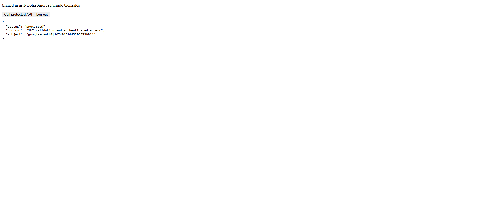
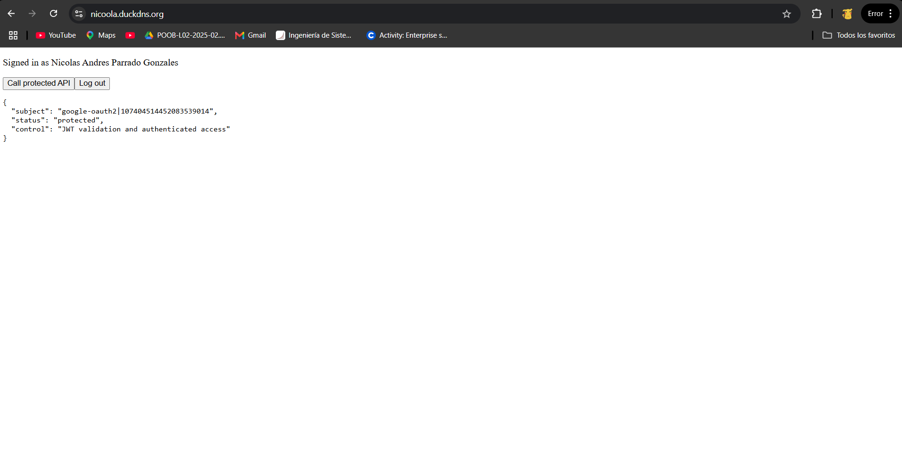

# Secure Web System as an Enterprise Risk Control

Deployed at: https://nicoola.duckdns.org

---

## What this is

A small web system built for a security workshop. The idea was to put together a React frontend, a Spring Boot backend, and Auth0 authentication, and then expose everything through HTTPS using a real certificate. Nothing fancy, but it covers the basics of how identity management and encryption in transit work as risk controls in a real system.

---

## How it works

The user logs in through Auth0 in the browser. Auth0 gives back an access token (JWT). The frontend sends that token to the backend with every request. The backend checks the token before responding — if there's no valid token, it returns 401 and that's it.

Everything goes through Apache with a Let's Encrypt certificate, so the connection is encrypted end to end. Port 8080 (the backend) is never exposed directly to the internet.

---

## Stack

- React + Vite (frontend)
- Spring Boot 3 + OAuth2 Resource Server (backend)
- Auth0 (authentication)
- Apache + Certbot (HTTPS reverse proxy)
- Duck DNS (public hostname)

---

## Screenshots

### 1. Successful authenticated API call


Logged in with Auth0 and called the protected endpoint. The backend returned the user identity and confirmed the JWT was valid. Tested first on localhost and then on the live deployment at nicoola.duckdns.org — same result both times.

### 2. Valid HTTPS certificate


The site runs on HTTPS with a real Let's Encrypt certificate. No browser warnings, just the lock icon. Verified on localhost during development and confirmed again on the public URL after deploying to the server.

---

## Risk controls covered

| Control | What it protects against |
|---|---|
| Auth0 login | Someone pretending to be another user |
| JWT validation at the API | Requests without a valid identity |
| Audience validation | Using a token meant for another API |
| HTTPS with valid certificate | Credentials or tokens being intercepted |
| Apache reverse proxy | Direct access to the application port |

---

## Running locally

```bash
# backend
cd backend
mvn spring-boot:run

# frontend
cd frontend
npm install
npm run dev
```

Frontend runs at `http://localhost:5173`, backend at `http://localhost:8080`.
